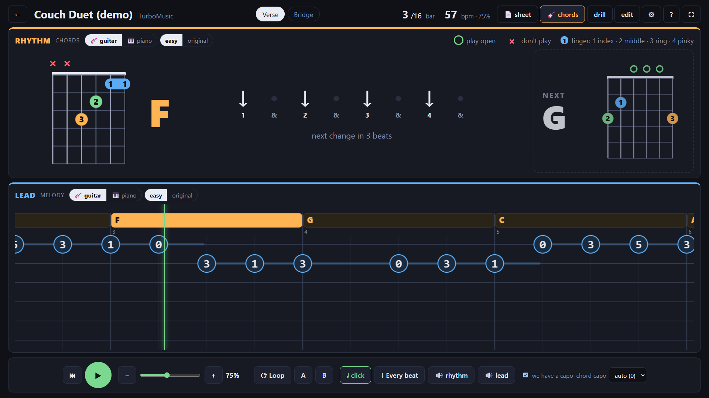
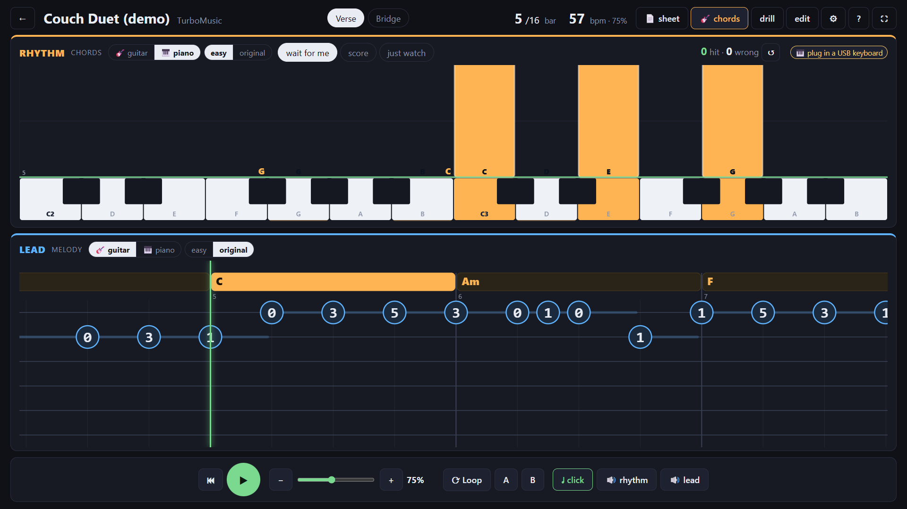
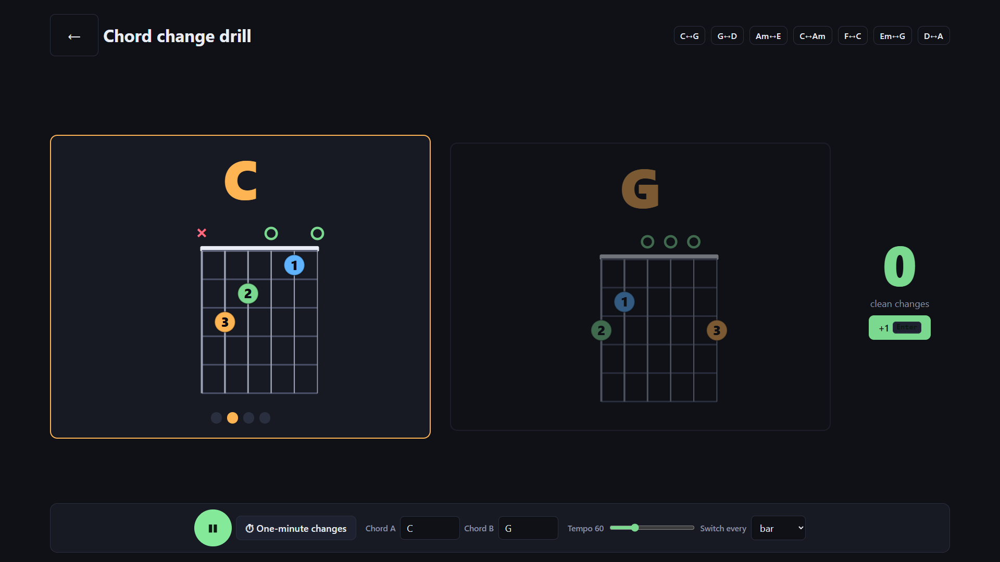
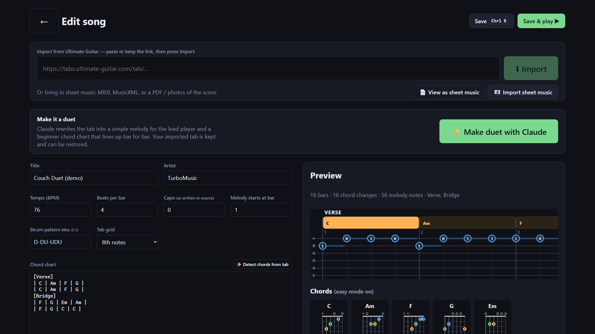
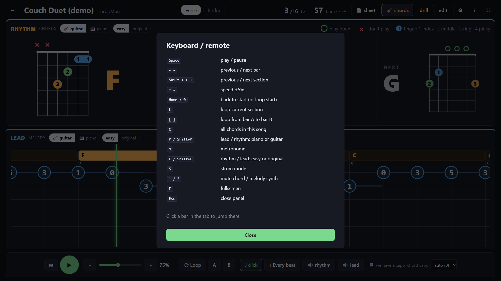
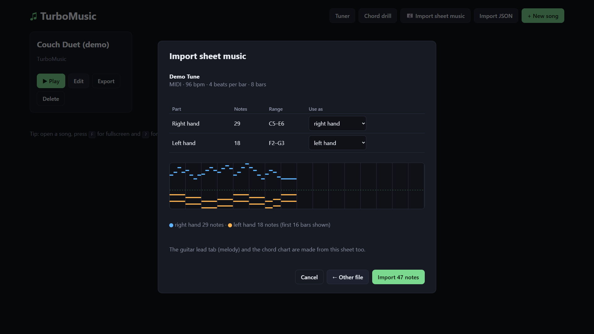
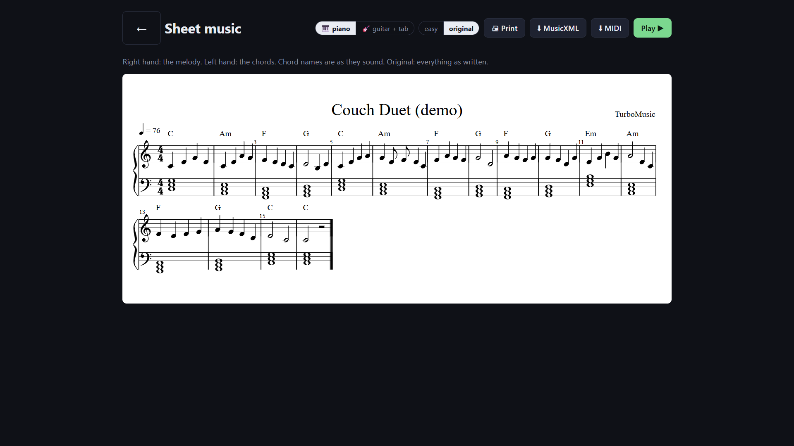

# TurboMusic

Learn songs together as a duet. One player plays the **chords**, the other the **melody**, and each picks their own **instrument** (guitar or piano with a USB keyboard) and **level** (easy or original). Guitar chords get big diagrams, a strum pattern and a "change in 3-2-1" cue; guitar melody is a scrolling tab; piano parts are falling notes over a keyboard. Both share one clock with count-in, metronome, speed control and looping, and any song can be shown as printable sheet music.

> **Coming soon:** parts for more instruments (bass, ukulele and more), so the whole band can play along.






<table>
  <tr>
    <td width="50%"><br><sub><b>Chords to learn</b> (<kbd>C</kbd>): every shape in the song, how hard it is and how much of the song it covers, plus the most common changes to drill.</sub></td>
    <td width="50%"><br><sub><b>Chord-change drill</b>: switch between two chords in time, with a one-minute-changes counter.</sub></td>
  </tr>
  <tr>
    <td><br><sub><b>Editor</b>: import from Ultimate Guitar, let Claude turn it into a duet, live preview.</sub></td>
    <td><br><sub><b>Tuner</b>: mic-based, shows the nearest guitar string.</sub></td>
  </tr>
  <tr>
    <td><br><sub><b>Keyboard / remote</b> (<kbd>?</kbd>): everything works from a keyboard or TV remote.</sub></td>
    <td><br><sub><b>Library</b>: your songs, import/export as JSON.</sub></td>
  </tr>
  <tr>
    <td><br><sub><b>Import sheet music</b>: MIDI, MusicXML or a PDF/photo; pick which part is which hand, then get piano, guitar lead and chords in one go.</sub></td>
    <td><br><sub><b>Sheet music</b> (📄 sheet): any song as a piano grand staff or guitar notation + tab, easy or original. Print, or download MusicXML / MIDI.</sub></td>
  </tr>
</table>

Screenshots are generated, not hand-made: `npm run screenshots` builds the app, starts a throwaway server with only the demo song (your own songs are never shown), drives headless Chrome through each screen with puppeteer-core and writes `docs/screenshots/*.png`. It finds Chrome/Edge/Chromium automatically; set `CHROME_PATH` if it can't.

## Each player: instrument and level

Every lane header has the same two switches, so each player sets up their own part:

| | 🎸 guitar | 🎹 piano |
|---|---|---|
| **Chords, easy** | open-chord shapes, with a capo when that makes them easier | simple chords in one hand position (or just root notes, in ⚙) |
| **Chords, original** | the chords exactly as written | the real left hand (sheet-music songs), otherwise full chords |
| **Melody, easy** | the simplified melody tab | one note at a time (top line) |
| **Melody, original** | the full tab as imported | the real right hand, or the full tab, all notes |

Any mix works: chords on piano + melody on guitar, both on guitar, both on piano (piano 4-hands), and so on. Keys: <kbd>P</kbd> / <kbd>Shift</kbd>+<kbd>P</kbd> switch melody / chords between guitar and piano, <kbd>E</kbd> / <kbd>Shift</kbd>+<kbd>E</kbd> switch chords / melody between easy and original. Piano melody has a **+ left hand** chip for one person playing the whole piano part.

All parts are in the same key, capo included, so mixed instruments sound right together. Each player's part plays on their own volume/mute button (**rhythm** / **lead** in the bottom bar), whether it's guitar or piano: listen first, mute your own part once you know it.

## Tab ↔ piano sheet

- **In the player** a part switches between guitar and piano with one click; a guitar song becomes a piano part (melody in the right hand, chords in the left) and a piano song becomes guitar tab + chords.
- **📄 sheet** (top bar, or *View as sheet music* in the editor) shows the song as real notation: **piano** (grand staff with chord symbols) or **guitar** (notes + tab staff, capo marked), easy or original. **Print** it, or download **MusicXML** (opens in MuseScore, Finale, Sibelius) or **MIDI**.
- **In the editor**, a song with a piano part has *Rebuild guitar tab + chords from it*: regenerates the easy melody tab, the full tab and the chord chart.

## Piano with a USB keyboard

Plug a MIDI keyboard or digital piano in over USB (or Bluetooth MIDI) and it's picked up automatically, hot-plugging included. The browser asks once for permission to use MIDI devices.

- **wait for me**: the song stops at each note or chord until you play it, then carries on. Best for learning.
- **score**: the song keeps going; each note played within about 0.2 s counts as a hit, with misses, wrong keys, accuracy and best streak.
- **just watch**: no checking.

Options in ⚙: accept the right note in any octave (default on, handy on 49/61-key keyboards), play a sound for your keys (turn off if your keyboard has speakers), key volume, falling speed. The sustain pedal works. You can also click the on-screen keys with a mouse.

Both players on piano with two keyboards plugged in: each piano lane gets a picker for which keyboard it listens to. In wait mode the song waits until **both** players have played their notes.

MIDI needs **Chrome or Edge**, and a page served from `http://localhost` or `https://` (a Cloudflare tunnel is fine; a plain `http://192.168.x.x` LAN address is blocked by the browser).

## Run

```bash
npm install
npm run build      # build the frontend into dist/
npm start          # http://localhost:3000 (API + app on one port)
```

Development (hot reload): `npm run dev` → open http://localhost:5173 (Vite proxies `/api` to the server on :3000).

Tests: `npm test` · Typecheck: `npm run typecheck`

Songs are stored as JSON in `data/songs/` (git-ignored; the demo song is seeded on first start). Override with `DATA_DIR=...`. Port: `PORT=...`.

## On the TV

HDMI from the laptop: open http://localhost:3000, pick a song, press **F** for fullscreen. A wireless keyboard or air-mouse remote works:

| Key | Action |
|---|---|
| Space | play / pause (with count-in bar) |
| ← → / Shift+← → | prev/next bar / section |
| ↑ ↓ | speed ±5% |
| Home | back to start (or loop start) |
| L | loop current section · `[` `]` loop bar A → bar B |
| E / Shift+E | chords / melody: easy ↔ original |
| P / Shift+P | melody / chords: guitar ↔ piano |
| S / M | strum mode / metronome |
| 1 / 2 | mute the chords / melody part |
| ? | help |

Click a bar in the tab to jump there. If the screen and sound drift apart on the TV, adjust **A/V offset** in ⚙ settings.

## For the beginner (chord player)

- **easy** level simplifies chords: drops extensions and slash basses, uses an easy F (xx3211), and swaps Bm → Bm7 and B → B7. **original** shows them as written.
- **Strum mode**: once per chord → every beat → the song's pattern. Step up as it gets comfortable.
- **Chord capo**: an extra capo just for the chord player. Shapes are transposed down, so the sound stays the same. The player suggests one when it would clearly make the shapes easier.
- **Drill** (`#/drill`): alternate two chords on a click. Also has "one-minute changes" counting (press Enter for +1).
- **Tuner** (`#/tuner`): needs microphone access, which only works on localhost or HTTPS.

## Importing sheet music

Library → **🎼 Import sheet music** (or the same button in the editor). Drop a file in:

| Format | How it's read | Notes |
|---|---|---|
| **MIDI** (`.mid`) | in the browser, exact | Tracks are listed; piano tracks are picked automatically. Two tracks → the higher one is the right hand. |
| **MusicXML** (`.musicxml`, `.xml`, `.mxl`) | in the browser, exact | What MuseScore, Finale, Sibelius, Dorico export. Grand staff → upper staff right hand, lower staff left hand. Ties, chords, several voices, pickup bars, repeats and 1st/2nd endings are handled. |
| **PDF or photos** (`.pdf`, `.png`, `.jpg`, several pages at once) | by Claude (needs `ANTHROPIC_API_KEY`) | Takes ~10 s for a page to a few minutes for a long piece. Check it by ear: mistakes are possible on dense or blurry scores. |

MuseScore files (`.mscz`): in MuseScore use *File → Export → MusicXML*. Guitar Pro: export MusicXML or MIDI.

Before importing you see each part with its note range and a small preview, and choose per part: both hands (split by staff, or at middle C), right hand, left hand, or skip it (drums are skipped by default). From one import you get:

- **Piano part**: both hands, exactly as written (onsets snapped to a fine 16th/triplet grid), shown in piano mode.
- **Guitar lead tab**: the top line of the right hand, moved into the guitar's middle register and fingered in low positions.
- **Chord chart** for the rhythm player, detected from the harmony bar by bar (or half bar when it clearly changes).

Try it with the example files in [`docs/examples/`](docs/examples) (an original 8-bar tune as `.mid` and `.mxl`).

On piano the app plays the piano part itself, each player's hand on their own volume button. Sheet imports also keep the full right hand as a guitar tab (the melody's *original* level).

## Adding a song by hand

Library → **+ New song** (or edit an existing one). Paste:

**Chord chart**
```
[Verse]
| C | Am | F G | % |      one bar per |, "F G" splits the bar, % repeats bar
| C . . G |               "." holds: C for 3 beats, G for 1
| F | G | x2              repeat the line
```

**Melody tab**: standard 6-line ASCII tab with the high e on top, pasted straight from a tab site. Tab has no rhythm information, so each note is timed by its column inside the bar and snapped to the grid you pick (8ths or 16ths). Check the editor preview and adjust the grid, or space the tab evenly, if notes land oddly. Use **Melody starts at bar** for chord-only intros and **Capo** if the source is written for one.

Back up or share songs with **Export / Import JSON** in the library.

## Exposing it later (Cloudflare Tunnel etc.)

Everything runs on one port, so a tunnel only needs to point at `http://localhost:3000`. **Set a password first**, because the API can edit and delete songs:

```bash
APP_PASSWORD=something-long npm start          # basic auth, user "guitar" (override with APP_USER)
cloudflared tunnel --url http://localhost:3000
```

Or put Cloudflare Access in front of it instead.

## Layout

```
server/index.ts        Express: /api/songs CRUD (JSON files), serves dist/, optional basic auth
shared/                Song type + demo song (used by server and client)
src/music/             theory, chord voicings + difficulty/capo advice, chart & tab parsers, arrangement, parts (instrument x level), practice scoring
src/audio/engine.ts    Web Audio lookahead scheduler, Karplus-Strong guitar synth, metronome, loop
src/audio/tuner.ts     mic pitch detection
src/audio/midi.ts      Web MIDI keyboard input (USB/Bluetooth), sustain pedal
src/import/            sheet-music import: MIDI + MusicXML/.mxl parsers, hand split, piano -> guitar tab + chords
src/export/            MusicXML + MIDI writers, song -> piano / guitar score (rendered by OpenSheetMusicDisplay)
server/transcriber.ts  PDF/photo sheet music read by Claude (background job, polled by the client)
src/views/             Library, Player, Editor, Sheet, Drill, Tuner
src/components/        ChordDiagram (SVG), Timeline (scrolling tab), ChordLane, PianoLane (falling notes), settings
scripts/screenshots.ts headless-Chrome screenshot generator for this README
```
