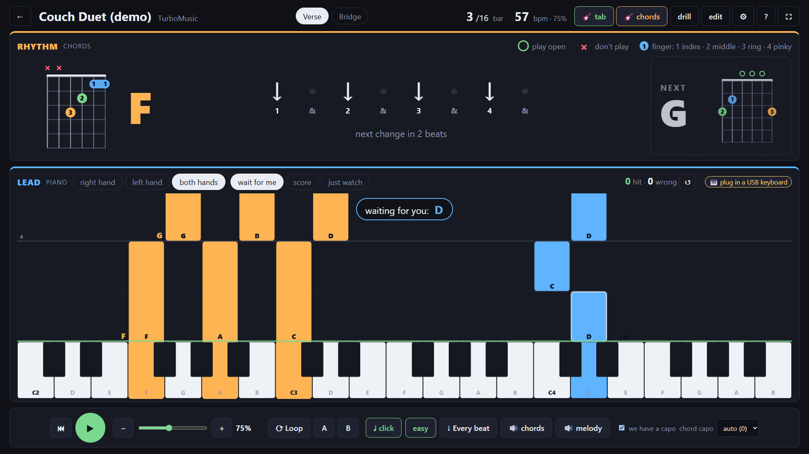
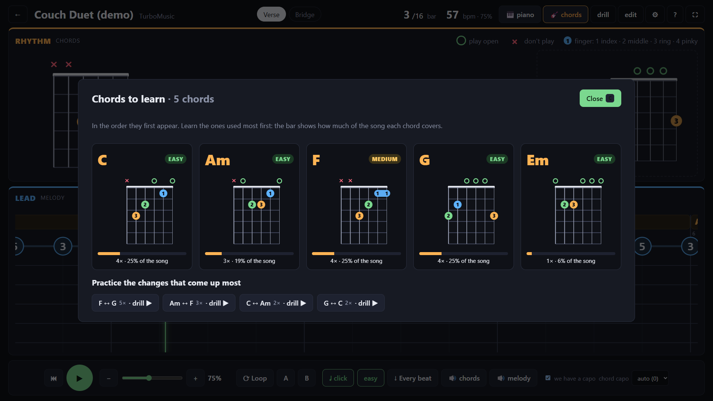
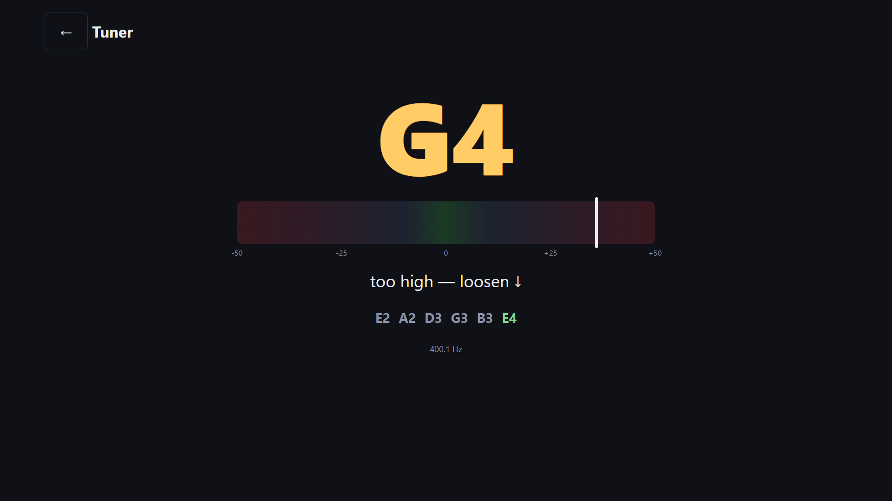
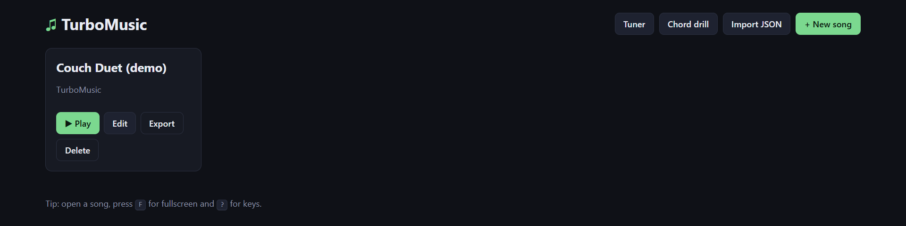

# TurboMusic

Learn songs together as a guitar duet. One player follows **chords** (big chord diagrams, strum pattern, "change in 3-2-1" cue), the other follows a scrolling **melody tab**, or plays it on **piano** with a USB keyboard. Both share one clock with count-in, metronome, speed control and looping.

> **Coming soon:** parts for more instruments (bass, ukulele and more), so the whole band can play along.




<table>
  <tr>
    <td width="50%"><br><sub><b>Chords to learn</b> (<kbd>C</kbd>): every shape in the song, how hard it is and how much of the song it covers, plus the most common changes to drill.</sub></td>
    <td width="50%"><br><sub><b>Chord-change drill</b>: switch between two chords in time, with a one-minute-changes counter.</sub></td>
  </tr>
  <tr>
    <td><br><sub><b>Editor</b>: import from Ultimate Guitar, let Claude turn it into a duet, live preview.</sub></td>
    <td><br><sub><b>Tuner</b>: mic-based, shows the nearest guitar string.</sub></td>
  </tr>
  <tr>
    <td><br><sub><b>Keyboard / remote</b> (<kbd>?</kbd>): everything works from a keyboard or TV remote.</sub></td>
    <td><br><sub><b>Library</b>: your songs, import/export as JSON.</sub></td>
  </tr>
</table>

Screenshots are generated, not hand-made: `npm run screenshots` builds the app, starts a throwaway server with only the demo song (your own songs are never shown), drives headless Chrome through each screen with puppeteer-core and writes `docs/screenshots/*.png`. It finds Chrome/Edge/Chromium automatically; set `CHROME_PATH` if it can't.

## Piano with a USB keyboard

Press <kbd>P</kbd> (or **🎹 piano** in the top bar) and the lead part switches from guitar tab to falling notes over a keyboard. Every song gets a piano part automatically: the **right hand** plays the melody from the tab, the **left hand** plays the chord chart (root notes, simple 3-note chords or full chords, set in ⚙). It's in the same key as the guitars, capo included, so piano + guitar works as a duet.

Plug a MIDI keyboard or digital piano in over USB (or Bluetooth MIDI) and it's picked up automatically, hot-plugging included. The browser asks once for permission to use MIDI devices.

- **wait for me**: the song stops at each note or chord until you play it, then carries on. Best for learning.
- **score**: the song keeps going; each note played within about 0.2 s counts as a hit, with misses, wrong keys, accuracy and best streak.
- **just watch**: no checking.

Options in ⚙: accept the right note in any octave (default on, handy on 49/61-key keyboards), play a sound for your keys (turn off if your keyboard has speakers), key volume, falling speed. The sustain pedal works. You can also click the on-screen keys with a mouse.

MIDI needs **Chrome or Edge**, and a page served from `http://localhost` or `https://` (a Cloudflare tunnel is fine; a plain `http://192.168.x.x` LAN address is blocked by the browser).

## Run

```bash
npm install
npm run build      # build the frontend into dist/
npm start          # http://localhost:3000 (API + app on one port)
```

Development (hot reload): `npm run dev` → open http://localhost:5173 (Vite proxies `/api` to the server on :3000).

Tests: `npm test` · Typecheck: `npm run typecheck`

Songs are stored as JSON in `data/songs/` (git-ignored; the demo song is seeded on first start). Override with `DATA_DIR=...`. Port: `PORT=...`.

## On the TV

HDMI from the laptop: open http://localhost:3000, pick a song, press **F** for fullscreen. A wireless keyboard or air-mouse remote works:

| Key | Action |
|---|---|
| Space | play / pause (with count-in bar) |
| ← → / Shift+← → | prev/next bar / section |
| ↑ ↓ | speed ±5% |
| Home | back to start (or loop start) |
| L | loop current section · `[` `]` loop bar A → bar B |
| E / S / M | easy chords / strum mode / metronome |
| 1 / 2 | mute chord / melody synth |
| ? | help |

Click a bar in the tab to jump there. If the screen and sound drift apart on the TV, adjust **A/V offset** in ⚙ settings.

## For the beginner (chord player)

- **easy** mode simplifies chords: drops extensions and slash basses, uses an easy F (xx3211), and swaps Bm → Bm7 and B → B7.
- **Strum mode**: once per chord → every beat → the song's pattern. Step up as it gets comfortable.
- **Chord capo**: an extra capo just for the chord player. Shapes are transposed down, so the sound stays the same. The player suggests one when it would clearly make the shapes easier.
- **Drill** (`#/drill`): alternate two chords on a click. Also has "one-minute changes" counting (press Enter for +1).
- **Tuner** (`#/tuner`): needs microphone access, which only works on localhost or HTTPS.

## Adding a song

Library → **+ New song** (or edit an existing one). Paste:

**Chord chart**
```
[Verse]
| C | Am | F G | % |      one bar per |, "F G" splits the bar, % repeats bar
| C . . G |               "." holds: C for 3 beats, G for 1
| F | G | x2              repeat the line
```

**Melody tab**: standard 6-line ASCII tab with the high e on top, pasted straight from a tab site. Tab has no rhythm information, so each note is timed by its column inside the bar and snapped to the grid you pick (8ths or 16ths). Check the editor preview and adjust the grid, or space the tab evenly, if notes land oddly. Use **Melody starts at bar** for chord-only intros and **Capo** if the source is written for one.

Back up or share songs with **Export / Import JSON** in the library.

## Exposing it later (Cloudflare Tunnel etc.)

Everything runs on one port, so a tunnel only needs to point at `http://localhost:3000`. **Set a password first**, because the API can edit and delete songs:

```bash
APP_PASSWORD=something-long npm start          # basic auth, user "guitar" (override with APP_USER)
cloudflared tunnel --url http://localhost:3000
```

Or put Cloudflare Access in front of it instead.

## Layout

```
server/index.ts        Express: /api/songs CRUD (JSON files), serves dist/, optional basic auth
shared/                Song type + demo song (used by server and client)
src/music/             theory, chord voicings + difficulty/capo advice, chart & tab parsers, arrangement, piano part, practice scoring
src/audio/engine.ts    Web Audio lookahead scheduler, Karplus-Strong guitar synth, metronome, loop
src/audio/tuner.ts     mic pitch detection
src/audio/midi.ts      Web MIDI keyboard input (USB/Bluetooth), sustain pedal
src/views/             Library, Player, Editor, Drill, Tuner
src/components/        ChordDiagram (SVG), Timeline (scrolling tab), ChordLane, PianoLane (falling notes), settings
scripts/screenshots.ts headless-Chrome screenshot generator for this README
```
